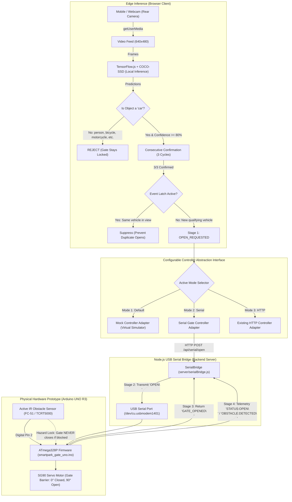

# SMARTPARK AI

### Mobile Camera-Based Car Detection & Automatic IoT Parking Gate Control (Arduino UNO Integration)

**SMARTPARK AI** is an edge computer vision web application and IoT hardware control system that integrates intelligent, camera-based vehicle detection with an **Arduino UNO R3** automatic parking gate prototype while preserving hardware-level safety mechanisms and obstacle detection.

The system performs **100% on-device AI inference** inside the mobile or desktop browser using **TensorFlow.js** and **COCO-SSD** to identify approaching cars, reject non-car objects, and issue gate-opening requests to an Arduino UNO via a **Node.js USB Serial Bridge**.

---

## 1. End-to-End System Architecture



---

## 2. Hardware Wiring Documentation

| Component | Component Pin | Arduino UNO Pin | Wire / Connection Details |
| :--- | :--- | :--- | :--- |
| **SG90 Servo** | Signal (PWM) | **Digital Pin 9** | Orange / Yellow wire |
| **SG90 Servo** | VCC | **5V** | Red wire (to Arduino 5V or breadboard power rail) |
| **SG90 Servo** | GND | **GND** | Brown / Black wire (to common GND) |
| **IR Obstacle Sensor** | OUT | **Digital Pin 2** | Digital output pin with internal pullup |
| **IR Obstacle Sensor** | VCC | **5V** | Power rail |
| **IR Obstacle Sensor** | GND | **GND** | Ground rail |
| **Status LED** | Anode (+) | **Digital Pin 13** | Onboard Arduino LED indicates gate active |
| **Host PC Connection** | USB-B | **Laptop USB-A / Type-C** | Standard USB programming & serial cable |

> [!IMPORTANT]
> **IR Sensor Polarity Configuration**:
> Most standard IR obstacle sensors (e.g. FC-51) are **Active-LOW** (the OUT pin goes `LOW` when reflection is detected and `HIGH` when the path is clear).
> The firmware includes a clearly documented toggle:
> ```cpp
> const bool IR_ACTIVE_LOW = true;
> ```
> If your IR module is Active-HIGH, set this constant to `false`.

---

## 3. Four-Stage Verification Pipeline

The UI explicitly separates the communication stages so that no false claims are made regarding physical gate position:

```
[Stage 1: Requested] ──> [Stage 2: Transmitted] ──> [Stage 3: Acknowledged] ──> [Stage 4: Hardware Confirmed]
```

1. **Stage 1 (Requested)**: The AI confirms 3/3 consecutive car frames and issues an open request.
2. **Stage 2 (Transmitted)**: Node.js dispatches the newline-terminated `OPEN\n` command over USB serial to the Arduino.
3. **Stage 3 (Acknowledged)**: The Arduino firmware executes the servo movement and transmits `GATE_OPENED\n` back across the serial line.
4. **Stage 4 (Confirmed)**: Telemetry confirms Arduino state is `OPEN`. Note that standard SG90 servos are open-loop actuators; physical confirmation is provided via controller acknowledgment and IR safety clearance.

---

## 4. Hardware Safety Rules

1. **AI is a Trigger Only**: The camera AI only *requests* gate opening upon verified car detection. It does not control motor pins directly.
2. **IR Sensor Enforces Physical Safety**: The Arduino firmware continuously reads the IR obstacle sensor. If an obstacle or vehicle is present in the gate passage, **the gate will NEVER close**, even if a close command is received.
3. **No Automatic Closing from Frontend**: The frontend never forces closing when the AI stops detecting a vehicle.
4. **Event Latch & Debounce**: Once a car triggers the gate, the event latch prevents duplicate `OPEN` commands from firing every frame while the vehicle is still in camera view. The latch automatically resets only after the vehicle clears the entrance.
5. **Disconnection Handling**: If the Arduino is unplugged or disconnected, the system enters `DISCONNECTED` state, ceases sending commands, and alerts the user.

---

## 5. Serial Communication Protocol

- **Baud Rate**: `9600`
- **Command Delimiter**: `\n` (newline-terminated)

### Commands (Host $\rightarrow$ Arduino)
| Command | Payload | Description |
| :--- | :--- | :--- |
| `OPEN` | `OPEN\n` | Raises gate barrier to 90° |
| `CLOSE` | `CLOSE\n` | Lowers gate barrier to 0° (only if IR sensor is CLEAR) |
| `STATUS` | `STATUS\n` | Queries current gate and sensor state |

### Acknowledgments (Arduino $\rightarrow$ Host)
| Message | Meaning |
| :--- | :--- |
| `SMARTPARK_READY` | Arduino firmware initialized and ready |
| `GATE_OPENED` | Gate barrier opened to 90° |
| `GATE_CLOSED` | Gate barrier closed to 0° |
| `STATUS:OPEN` / `STATUS:CLOSED` | Current barrier position |
| `OBSTACLE:DETECTED` / `OBSTACLE:CLEAR` | IR obstacle safety status |
| `OBSTACLE_DETECTED` | CLOSE command refused because an obstacle is in the barrier path |
| `ERROR:UNKNOWN_COMMAND` | Command rejected |

---

## 6. Arduino Firmware Upload Instructions

1. Open the [Arduino IDE](https://www.arduino.cc/en/software).
2. Open [`firmware/smartpark_gate_uno/smartpark_gate_uno.ino`](file:///Users/kshitijrenge/Downloads/robotics/firmware/smartpark_gate_uno/smartpark_gate_uno.ino).
3. Connect your **Arduino UNO R3** to your laptop via USB cable.
4. In the Arduino IDE:
   - Select **Tools $\rightarrow$ Board $\rightarrow$ Arduino Uno**.
   - Select **Tools $\rightarrow$ Port $\rightarrow$ `/dev/cu.usbmodem1401`** (or your platform's COM port).
5. Click **Upload** (Ctrl+U or Cmd+U).
6. Once uploaded, close the Arduino Serial Monitor so the Node.js server can bind to the port.

---

## 7. Local Setup & Configuration

### Prerequisites
- Node.js (v18.x or later)
- Arduino UNO connected via USB

### Installation
```bash
# 1. Navigate to project root
cd /Users/kshitijrenge/Downloads/robotics

# 2. Install dependencies (Express + SerialPort)
npm install
```

### Configuration (Environment Variables)
You can configure the serial connection via environment variables or via the UI settings card:

```bash
# Option A: Auto-detect Arduino UNO port (Default)
npm start

# Option B: Explicitly specify port and baud rate
SERIAL_PORT=/dev/cu.usbmodem1401 SERIAL_BAUD_RATE=9600 npm start

# Option C: Run in simulation mode (Mock hardware without Arduino)
npm run mock
```

---

## 8. Mobile Camera Testing & HTTPS Guidelines

Mobile browsers (iOS Safari & Android Chrome) require a secure origin (`localhost` or `HTTPS`) to grant camera access (`getUserMedia`):

### Testing Options:
1. **Desktop / Laptop Webcam**:
   - Open [`http://localhost:3000`](http://localhost:3000) directly.
2. **Android Phone via Chrome USB Remote Debugging (Recommended)**:
   - Connect phone via USB with USB Debugging enabled.
   - Run port forwarding in your terminal:
     ```bash
     adb reverse tcp:3000 tcp:3000
     ```
   - Open `http://localhost:3000` in Chrome on the Android phone. Camera access works directly!
3. **Secure HTTPS Tunnel (For iOS or Wireless Android)**:
   - Run:
     ```bash
     npx cloudflared tunnel --url http://localhost:3000
     ```
   - Open the provided `https://...` link on your mobile device.

---

## 9. Automated Testing Suite

SMARTPARK AI includes an extensive, hardware-independent automated unit test suite:

```bash
# Run all tests
npm test

# Run dedicated serial bridge tests
npm run test:serial
```

### Test Coverage (37 Tests Total):
- **Suite 1**: Car detection & non-car rejection (`person`, `bicycle`, `motorcycle`, `bus`, `truck`, empty scene).
- **Suite 2**: Confidence threshold filtering (passes $\ge$ 80%, rejects $<$ 80%).
- **Suite 3**: Consecutive confirmation counter (3 cycles) and immediate reset on interruption.
- **Suite 4**: Command debouncing and anti-bounce suppression.
- **Suite 5**: Mock controller virtual cycle and vehicle count tracking.
- **Suite 6**: HTTP controller error and timeout handling.
- **Suite 7**: Event latching & duplicate OPEN prevention while vehicle is in view.
- **Suite 8**: Serial bridge command formatting (`OPEN\n`, `CLOSE\n`, `STATUS\n`).
- **Suite 9**: Arduino acknowledgment parsing (`SMARTPARK_READY`, `GATE_OPENED`, etc.).
- **Suite 10**: IR obstacle safety enforcement (gate refuses close when obstacle detected).
- **Suite 11**: Serial disconnection and in-flight command recovery.
- **Suite 12**: Command timeout handling.
